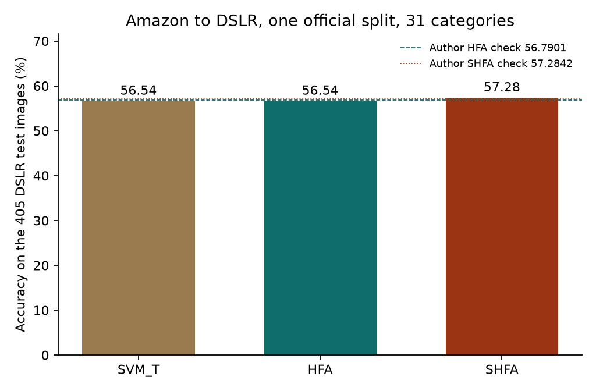
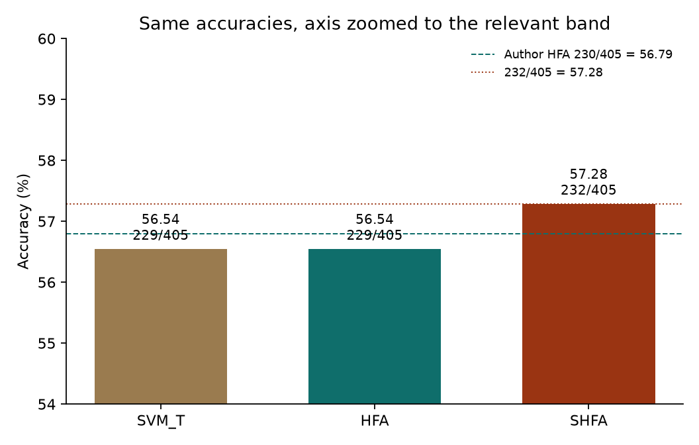
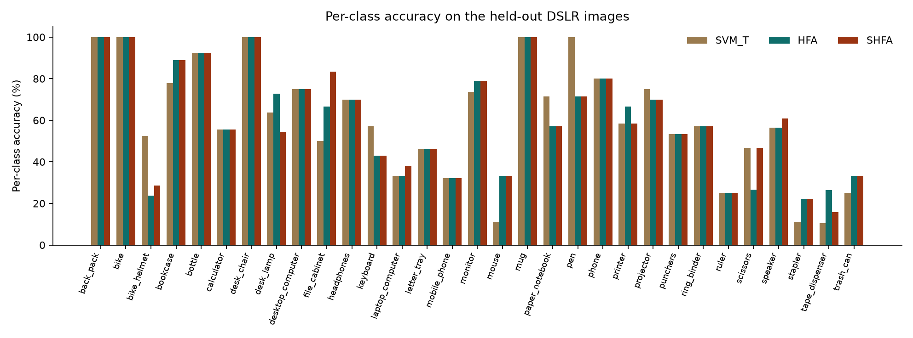
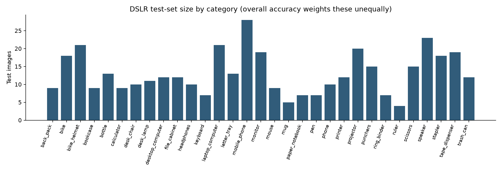
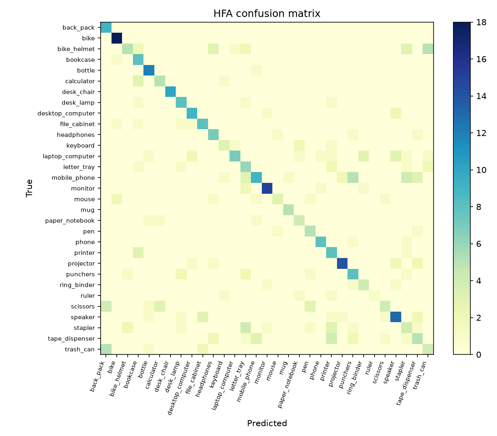
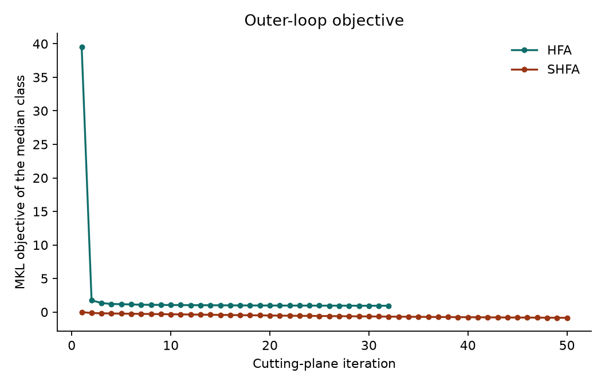

# Results: authors' Amazon → DSLR check

The numbers below were produced by `reproduce_official.py` from the data and parameters shipped in `../matlab_implementation/official_shfa_release/`. That folder is the public MATLAB release of Wen Li ([wenli-vision/SHFA_release](https://github.com/wenli-vision/SHFA_release)). This machine has the MATLAB runtime only, so `demo.m` cannot be executed. The Python program is a port of `demo.m`, `demo_shfa.m`, `train_hfa_mkl.m`, `train_shfa_pnorm.m`, `LpMKL_H_fast.m`, `LpMKL_H_labels_v4.m`, and `libs/sumkernels/sumkernels.cpp`. The SVM subproblems are the same ones those files call: C-SVM for HFA, one-class SVM (`ν = 1/n`) for SHFA, both on a precomputed kernel, with LIBSVM's default stopping tolerance `10^{-3}`.

An RTX 5070 Ti (12 GB) is installed. It was not used. The official solver is cutting-plane multiple-kernel learning around LIBSVM, which is a CPU method. Replacing it with a GPU solver would no longer be the authors' algorithm.

## What was wrong in the previous workspace

`hfa_numpy.py` does not implement the TPAMI algorithm. It alternates a linear hinge solver with updates of `P` and `Q`. That is the style of the ICML 2012 precursor, which the TPAMI paper replaces because the alternation is not known to reach the global solution. `run_demo.py` trains that model on a synthetic Gaussian problem and never touches the Office split. The shipped MATLAB files are the 31-category Office set: `categories.mat` has 31 names, and `return_object_target_index_diff_number.m` hard-codes `CLASS_NUM = 31`.

## Data and protocol

SURF bag-of-words features from the authors' matrices, columns \(\ell_2\)-normalized, Gaussian kernel with bandwidth set from the mean squared distance (diagonal included), \(C=1\), \(\lambda=100\).

| Role | Domain | Feature dim. | Samples |
|---|---|---:|---:|
| Source | Amazon | 800 | 20 per class, 620 |
| Labeled target | DSLR | 600 | 3 per class, 93 |
| Test | DSLR | 600 | the other 405 |

SHFA uses those 405 test images as unlabeled target training data, and it sets each category's unlabeled positive rate to the true rate in the test labels. Both choices are what `demo_shfa.m` does, and the paper states that the same class prior is given to its T-SVM baseline. Individual test labels are not used as training labels. The score is transductive.

SVM\(_T\) is the paper's target-only baseline: the same Gaussian kernel and \(C=1\), trained on the 93 labeled DSLR images, one-versus-all.

## Overall accuracy

| Method | Correct | Accuracy | Authors' printed check |
|---|---:|---:|---:|
| SVM\(_T\) | 229 / 405 | 0.565432 | not printed by the demo |
| HFA, \(p=1\) | 229 / 405 | 0.565432 | 0.567901, which is 230 / 405 |
| SHFA, \(p=1.5\) | 232 / 405 | 0.572840 | 0.572842 |





SHFA matches the authors' check at the only count consistent with it. On 405 images the possible accuracies are multiples of \(1/405 \approx 0.00247\). Their printed value 0.572842 sits 0.000002 away from \(232/405 = 0.5728395\), which rounds to 0.572840, and 0.0025 away from the next counts. The sixth-decimal character in the README is not a different image.

HFA is one image below the authors' 230 / 405. The port's decision function on the training kernel matches scikit-learn's SVM decision function to \(10^{-15}\), so the scoring formula is the one in `demo.m`. The remaining image is the difference between LIBSVM 3.20, which is the mex shipped in the release, and the LIBSVM build inside scikit-learn 1.9, at the same tolerance. The mex cannot be called without MATLAB.

On this single split, HFA and SVM\(_T\) tie at 229. They do not make the same mistakes: HFA is better on 9 categories and worse on 6, with 16 ties. The gains and losses cancel. That is compatible with the paper, which reports a mean over 20 splits rather than this one draw. This run does not recompute that mean. The release contains only these indices, only Amazon as the source, and neither the Reuters nor the sentiment collection.

Macro accuracy, the unweighted mean of the 31 per-class accuracies, is 0.600 for SVM\(_T\), 0.599 for HFA, and 0.604 for SHFA. It sits above the overall accuracy because several large categories are hard: mobile phone has 28 test images at 32% for every method, laptop computer has 21 at 33–38%, and bike helmet has 21 at 52% for SVM\(_T\) but only 24–29% once the source is added.

## Per-class accuracy



| Category | Test images | SVM\(_T\) | HFA | SHFA |
|---|---:|---:|---:|---:|
| back_pack | 9 | 100 | 100 | 100 |
| bike | 18 | 100 | 100 | 100 |
| bike_helmet | 21 | 52.4 | 23.8 | 28.6 |
| bookcase | 9 | 77.8 | 88.9 | 88.9 |
| bottle | 13 | 92.3 | 92.3 | 92.3 |
| calculator | 9 | 55.6 | 55.6 | 55.6 |
| desk_chair | 10 | 100 | 100 | 100 |
| desk_lamp | 11 | 63.6 | 72.7 | 54.5 |
| desktop_computer | 12 | 75.0 | 75.0 | 75.0 |
| file_cabinet | 12 | 50.0 | 66.7 | 83.3 |
| headphones | 10 | 70.0 | 70.0 | 70.0 |
| keyboard | 7 | 57.1 | 42.9 | 42.9 |
| laptop_computer | 21 | 33.3 | 33.3 | 38.1 |
| letter_tray | 13 | 46.2 | 46.2 | 46.2 |
| mobile_phone | 28 | 32.1 | 32.1 | 32.1 |
| monitor | 19 | 73.7 | 78.9 | 78.9 |
| mouse | 9 | 11.1 | 33.3 | 33.3 |
| mug | 5 | 100 | 100 | 100 |
| paper_notebook | 7 | 71.4 | 57.1 | 57.1 |
| pen | 7 | 100 | 71.4 | 71.4 |
| phone | 10 | 80.0 | 80.0 | 80.0 |
| printer | 12 | 58.3 | 66.7 | 58.3 |
| projector | 20 | 75.0 | 70.0 | 70.0 |
| punchers | 15 | 53.3 | 53.3 | 53.3 |
| ring_binder | 7 | 57.1 | 57.1 | 57.1 |
| ruler | 4 | 25.0 | 25.0 | 25.0 |
| scissors | 15 | 46.7 | 26.7 | 46.7 |
| speaker | 23 | 56.5 | 56.5 | 60.9 |
| stapler | 18 | 11.1 | 22.2 | 22.2 |
| tape_dispenser | 19 | 10.5 | 26.3 | 15.8 |
| trash_can | 12 | 25.0 | 33.3 | 33.3 |

The categories where the source helps on this split are file cabinet (50% → 83% with SHFA), mouse (11% → 33%), stapler (11% → 22%), tape dispenser (11% → 26% with HFA), and trash can (25% → 33%). The category where it hurts most is bike helmet (52% → 24% with HFA). SHFA gives back part of that loss and restores scissors from HFA's 27% to the target-only 47%, which is why its net gain over HFA is three images rather than a uniform lift.



## Where the errors go



Rows are the true DSLR category and columns are the prediction. The largest off-diagonal counts for HFA are trash can predicted as back pack (5), mobile phone predicted as punchers (5), and bike helmet predicted as trash can (5). SVM\(_T\) makes the trash-can/back-pack confusion 8 times; both adaptation methods cut it to 5 and do not remove it. Mobile phone, the largest test category, stays at 9 correct out of 28 under all three methods and leaks into punchers, staplers, and rulers. These are visually close office objects represented by different SURF codebooks, which is the setting the augmented map is supposed to help, and on this split it only partly does.

SHFA's largest confusions are the same three pairs, plus bike helmet predicted as stapler (5). Adding the unlabeled images moves errors around more than it clears them.

## Optimization

HFA's outer objective falls on every category. Ten of the 31 binary models hit the release cap of 50 cutting-plane rounds; the median model stops at 40; the fastest (`printer`) stops at 13. The figure below is the category whose final objective is the median. The first iteration drops from about 40 to about 2, and the rest is a steady decrease, which is what Theorem 2 describes.

SHFA's objective is the negative quadratic of the \(\rho\)-SVM dual, so it is negative and still moving at iteration 50 for every category. The relative tolerance \(10^{-3}\) therefore never fires, and the run stops on the same cap the authors set (`hfa_iter = 50`). The right-hand panel is that trajectory for the median category.



## Runtime

| Stage | Time |
|---|---:|
| SVM\(_T\), 31 binary models on 93 points | 0.02 s |
| HFA kernel square roots | 0.42 s |
| HFA, 31 cutting-plane models, \(n=713\) | 68.7 s |
| SHFA kernel square roots, including the unlabeled block | 2.8 s |
| SHFA, 31 cutting-plane models, \(n=1{,}118\) | 479 s |

Wall time for the whole script was about 9.2 minutes on the CPU. SHFA is slower because each model uses 405 extra points, rebuilds a sum of up to 50 base kernels, and always runs 50 outer rounds.

## How to rerun

From the workspace root, with the virtual environment already created:

```text
.venv\Scripts\python.exe python_implementation\reproduce_official.py
```

Outputs are `output/official_results.json`, `output/official_predictions.npz`, and `output/figures/` (under this directory). The algorithm write-up is `../HFA_SHFA_ALGORITHM.md`. The 15-minute deck is `../slides/index.html`.
